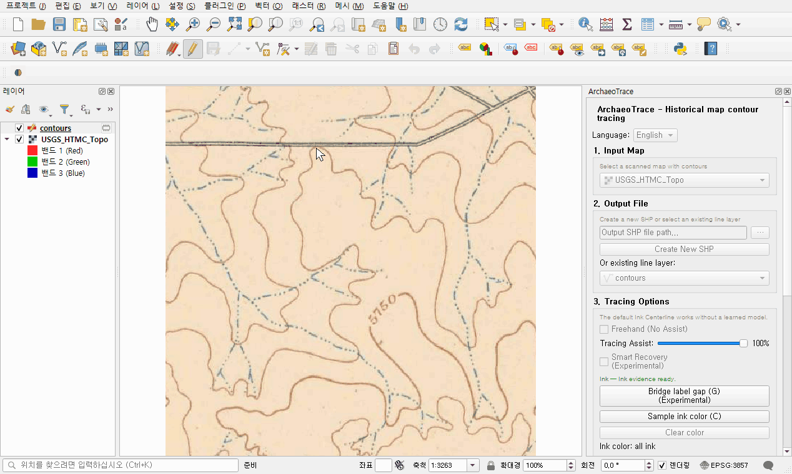
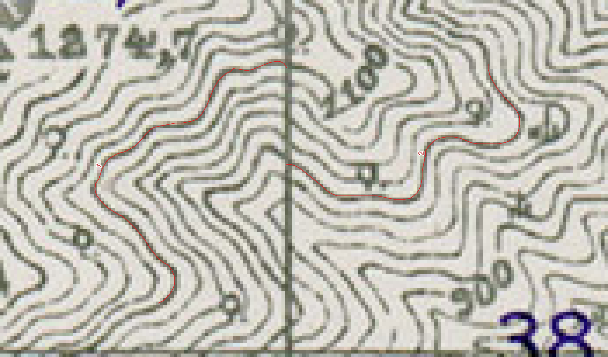

<p align="center">
  
</p>

<h1 align="center">ArchaeoTrace</h1>

<p align="center">
  <strong>Local-First, AI-Assisted Contour Tracing &amp; Historical Terrain Reconstruction for QGIS</strong><br>
  <sub>Human-in-the-loop vectorization of elevation contours from scanned historical topographic maps — built for archaeology, historical GIS, geomorphology, and landscape change research.</sub>
</p>

<p align="center">
  <a href="https://plugins.qgis.org/plugins/ai_vectorizer/"></a>
  
  <a href="https://github.com/lzpxilfe/AI-Vectorizer-for-Archaeology/actions/workflows/ci.yml"></a>
  
  
  
</p>

<p align="center">
  <strong><a href="README.md">한국어 README</a></strong> &middot;
  <a href="#why-archaeotrace">Why ArchaeoTrace</a> &middot;
  <a href="#key-capabilities-and-shortcuts">Capabilities</a> &middot;
  <a href="#how-it-works">How It Works</a> &middot;
  <a href="#quick-start">Quick Start</a> &middot;
  <a href="#validation-and-limitations">Validation &amp; Limits</a> &middot;
  <a href="#references-and-citation">References &amp; Citation</a>
</p>

<p align="center">
  
  <br>
  <sub>Live <strong>ArchaeoTrace</strong> session recorded in QGIS — tracing a sinuous historical contour (<code>5740</code>) in a handful of clicks with default <code>Ink Centerline v2</code> + <code>Live-Wire</code> (zero extra pip packages) and bridging the printed <code>5750</code> label gap with <code>G</code> (public-domain USGS HTMC map crop).</sub>
</p>

---

## Why ArchaeoTrace

Digitising elevation contours from scanned historical topographic sheets is one of the largest bottlenecks in archaeological survey, historical GIS, geomorphology, and long-term landscape-change studies. Clicking thousands of vertices by hand takes days; conversely, cloud black-box AI services force researchers to upload restricted archival maps and produce hard-to-audit geometry whenever lines cross text labels, hachures, or paper stains.

**ArchaeoTrace** keeps the analyst in full control through a **local-first, human-in-the-loop** workflow:

| Traditional Bottleneck | How ArchaeoTrace (`0.1.7`) Solves It |
| --- | --- |
| **Pure manual digitising** — tedious vertex-by-vertex clicking | Default **Ink Centerline v2** (9 / 15 / 31 source-pixel multi-scale evidence) + direction-aware **Live-Wire** traces printed contours in real time using **only QGIS's bundled NumPy — zero extra pip packages required.** |
| **Black-box automatic vectorisation** — drifts onto labels, hachures, or neighbouring lines | Real-time **green WYSIWYG preview** shows the exact path accepted on click, paired with a literal **0–100% cursor-to-path blend slider**, **gap bridge (`G`)**, **ink colour picker (`C`)**, **avoid regions (`Alt`+click)**, **`Shift`/`Ctrl` straight segments**, **endpoint resumption**, and **safe checkpoint `Ctrl+Z` Undo**. |
| **Faded, stained, or broken archival contours** — classical edge detectors stall | Optional **Smart Recovery (EfficientSAM-Ti ONNX)** and **Learned Contour Guidance (ResNet-18 dual-head U-Net ONNX)** — default OFF — act strictly under safety guards and fail closed to the Ink route whenever checks fail. |
| **Sensitive or restricted archival maps** — cannot leave local workstations | **100% local-first with zero usage telemetry.** Maps and tracing geometries are never sent to remote inference servers. Optional model downloads verify fixed byte sizes and SHA-256 hashes. |
| **Fragile one-off research scripts** — break across QGIS / Qt upgrades | Verified with **1,246 Pure Python tests + 226 actual QGIS 3.44.8 tests**, **0 official Qt6 checker warnings across 46 Python files**, **12-job CI covering QGIS 3.22 / 3.44 / 4.2**, and a built-in bilingual **English / Korean** UI. |

<p align="center">
  
  <br>
  <sub>Real-map Ink tracing pilot (<a href="docs/REAL_MAP_PILOT_2026-10-19.md">U.S. Army Map Service Korea 1:50,000 L751, Mupungjang 6721 I, Public Domain</a>) — zoomed render of traced centerlines across dense historical contours, printed elevation labels, and gridlines (storage-integrity pilot, not a general accuracy score).</sub>
</p>

---

## Key Capabilities and Shortcuts

| Capability / Mode | Purpose | Additional Runtime | Status |
| --- | --- | --- | --- |
| **Ink Centerline** *(default)* | Multi-scale (9/15/31px) & chromatic ink evidence + bounded Live-Wire | None (QGIS NumPy; SciPy optional) | Default |
| **Freehand & assist strength** | Literal `0–100%` cursor/path coordinate blending (`0%` = pure manual), `Shift`/`Ctrl`-click straight lines | None | Baseline |
| **Gap bridge (`G`)** | Preview and accept a smooth cubic Hermite curve across broken contours or text gaps | None | Built-in |
| **Ink colour (`C`) · avoid (`Alt`+click)** | Sample target contour ink hue and penalise distracting text, symbols, or stains | None | Built-in |
| **Endpoint resume & safe Undo** | Continue existing contours while preserving saved elevations; `Ctrl+Z` undoes checkpoints cleanly during an active trace | None | Built-in |
| **Smart Recovery · learned contour guide** | Optional local ONNX (`EfficientSAM-Ti` / `ResNet-18 U-Net`) corridor & prior guidance with fail-closed arbiter | `onnxruntime` + explicitly installed fixed-hash models | Optional (default OFF) |
| **Advanced / Legacy methods** | `LSD`, `HED`, `MobileSAM`, `SAM (ViT-B)`, `Legacy Canny` | OpenCV / PyTorch (optional) | Advanced / Legacy |
| **DEM & hillshade** | Linear-TIN DEM and GDAL Horn hillshade from saved contours and spot heights | None (QGIS & GDAL built-in) | Experimental |

---

## How It Works

ArchaeoTrace follows a conservative **Champion / Challenger** pipeline — an edge detector or neural mask is never saved automatically as cartographic or archaeological fact.

```text
Georeferenced Historical Map Raster (local file or user-selected WMS/WMTS)
  -> multi-scale (9/15/31px) Ink Centerline v2 evidence + optional Ink Colour (C) / Avoid Regions (Alt)
  -> bounded direction-aware Live-Wire [Ink Champion]
  -> optional (default OFF) Smart Recovery (EfficientSAM-Ti) / Learned Contour Guide (ONNX) [Challenger]
  -> safety arbiter (endpoint, detour, strong-Ink retention, branch-switch -> accept or Ink fallback)
  -> live green WYSIWYG preview + 0–100% cursor blend + Gap Bridge (G) + Shift/Ctrl straight + Ctrl+Z checkpoints
  -> QGIS edit buffer -> contour elevation & optional spot heights (Save Layer Edits)
  -> optional experimental linear-TIN DEM & GDAL hillshade reconstruction
```

Only segments explicitly accepted by the user enter the QGIS edit buffer, and writing to disk remains a deliberate `Save Layer Edits` action. See [`docs/FEATURES_AND_ARCHITECTURE.md`](docs/FEATURES_AND_ARCHITECTURE.md) and [`docs/INK_V2_SMART_RECOVERY.md`](docs/INK_V2_SMART_RECOVERY.md) for the complete architecture and fail-closed guarantees.

---

## Quick Start

### 1. Installation and Language

- **QGIS Plugin Repository**: Open `Plugins > Manage and Install Plugins`, enable **Show also experimental plugins**, and search for `ArchaeoTrace`. Candidate ZIPs can be installed via `Install from ZIP`.
- **Release status**: The latest approved repository version is [`0.1.6`](https://plugins.qgis.org/plugins/ai_vectorizer/). The resubmitted **`0.1.7`** package passed all five repository security checks (0 critical, 0 warnings) and the official Qt6 check (0 warnings), and is awaiting administrator approval ([Upload package validation](docs/QT6_UPLOAD_0.1.7.md) · [Security scan & baseline review](docs/SECURITY_SCAN_0.1.7.md)).
- **Built-in English / Korean switching**: Use `Language` at the top of the dock panel. On first launch the plugin follows the QGIS locale (Korean for Korean locales, English otherwise) and remembers your choice.
- **Zero extra pip to begin**: `Freehand` and default `Ink Centerline` run out of the box. Optional model install commands, pinned hashes, and troubleshooting live in the packaged [English user guide](ai_vectorizer/README.en.md) and [Korean guide](ai_vectorizer/README.md).

### 2. Trace Contours and Build a DEM

1. Select a georeferenced historical map raster and a 2D line output layer.
2. Choose `Ink Centerline`, set the `0–100%` assist strength, and start tracing.
3. Review the green preview and click to accept segments (`G` gap bridge, `C` sample ink colour, `Alt`+click avoid region, `Shift`/`Ctrl`-click straight segment, `Ctrl+Z` undo last checkpoint).
4. Extend directly from existing contour endpoints (saved elevations are preserved), then press `Enter` or right-click to finish and enter the elevation.
5. Run QGIS `Save Layer Edits`, then open the DEM dialog — verify the **elevation field** (field names other than `elevation` require explicit selection) and use a **projected CRS in metre units** to generate a linear-TIN DEM and hillshade.

---

## Validation and Limitations

ArchaeoTrace treats scientific transparency as a core engineering requirement — publishing both verified engineering checks and negative experimental results without hype.

- **Verified software & QGIS compatibility (`0.1.7`)**: **1,246 Pure Python tests passed** (171 subtests), **226 actual QGIS 3.44.8 tests passed** (0 failures/errors/skips), **0 findings/warnings** from the official QGIS Qt6 checker (QGIS 4.2.1 / Qt 6.9.2) across all 46 packaged Python files, and **12/12 passing CI jobs** covering native QGIS 3.22.16, 3.44.13, and 4.2.1 plus byte-identical Linux/Windows ZIP packaging. See the [0.1.7 review record](docs/RELEASE_REVIEW_2026-11-12.en.md).
- **Honest reporting of negative ML experiments**: Three-seed Colab training, ONNX validation, and matched QGIS comparisons were completed, but the new general-text model did not improve saved routes across the 13 positive cases among 17 diagnostics, so the existing Korea model and **default-OFF policy were retained**. A follow-up word-group detector experiment likewise yielded no route gain and was not adopted.
  - [Training & model comparison (ko)](learning/COLAB_KOREA_TEXT_WEAK_RUN_2026-10-19.md) · [Text-gap diagnosis (ko)](learning/GENERAL_TEXT_FAILURE_DIAGNOSIS_2026-10-19.md) · [Detector experiment (ko)](learning/WORD_GROUP_EXPERIMENT_2026-11-11.md) · [Real-map pilot (ko)](docs/REAL_MAP_PILOT_2026-10-19.md)
- **Scientific limits**: Quantitative accuracy against human-reviewed ground truth and time-saving benchmarks have not yet been formally established. Generated linear-TIN DEMs depend strongly on the supplied contours and should be interpreted as **reviewable terrain hypotheses against the source map, not archaeological ground truth**. Automated topology QA and uncertainty layers are planned for future work.

---

## Data Privacy & Local-First Design

- Map rasters, vector geometries, and local inference outputs are never uploaded to remote inference servers, and the plugin collects zero usage telemetry.
- Network access occurs only when reading a WMS/WMTS layer you select or downloading an optional model you explicitly request; all downloaded weights are verified against fixed byte sizes and SHA-256 checksums ([`SECURITY.md`](SECURITY.md)).

---

## References and Citation

All implemented morphological, shortest-path, cubic Hermite, deep-learning, and terrain-interpolation methods are documented with verified DOIs in [`REFERENCES.md`](REFERENCES.md).

If you use ArchaeoTrace in academic research, teaching, heritage documentation, or historical GIS work, please cite [`CITATION.cff`](CITATION.cff) (indexed via [`.zenodo.json`](.zenodo.json)) or the BibTeX entry below:

- Author: Jinseo Hwang ([ORCID: 0009-0000-8228-4083](https://orcid.org/0009-0000-8228-4083))

```bibtex
@software{ArchaeoTrace_Hwang_2026,
  author  = {Hwang, Jinseo},
  title   = {ArchaeoTrace: Local-First AI-Assisted Contour Tracing and Historical Terrain Reconstruction for QGIS},
  year    = {2026},
  version = {0.1.7},
  url     = {https://github.com/lzpxilfe/AI-Vectorizer-for-Archaeology}
}
```

---

## Repository Guide

| Path | Description |
| --- | --- |
| [`ai_vectorizer/README.en.md`](ai_vectorizer/README.en.md) · [`README.md`](ai_vectorizer/README.md) | Packaged bilingual user guides (optional model installs, SHA-256 hashes, shortcuts, troubleshooting) |
| [`REFERENCES.md`](REFERENCES.md) | Verified primary academic literature and DOIs for every method |
| [`docs/FEATURES_AND_ARCHITECTURE.md`](docs/FEATURES_AND_ARCHITECTURE.md) | Implemented, experimental, and planned scope plus safety architecture |
| [`docs/QT6_UPLOAD_0.1.7.md`](docs/QT6_UPLOAD_0.1.7.md) · [`docs/SECURITY_SCAN_0.1.7.md`](docs/SECURITY_SCAN_0.1.7.md) | `0.1.7` Qt6 upload package validation and repository security audit |
| [`docs/RELEASE_REVIEW_2026-11-12.en.md`](docs/RELEASE_REVIEW_2026-11-12.en.md) | `0.1.7` upgrade candidate review and verification scope |
| [`benchmarks/README.md`](benchmarks/README.md) · [`learning/README.md`](learning/README.md) | Reproducible benchmark harness and Colab training/diagnostic records |
| [`ROADMAP.md`](ROADMAP.md) · [`CHANGELOG.md`](CHANGELOG.md) | Development roadmap, deliberate non-goals, and changelog |
| [`CONTRIBUTING.md`](CONTRIBUTING.md) · [`SECURITY.md`](SECURITY.md) · [`LICENSE`](LICENSE) | Contributor guide & deterministic packaging, security policy, GNU GPL v2.0 licence |
