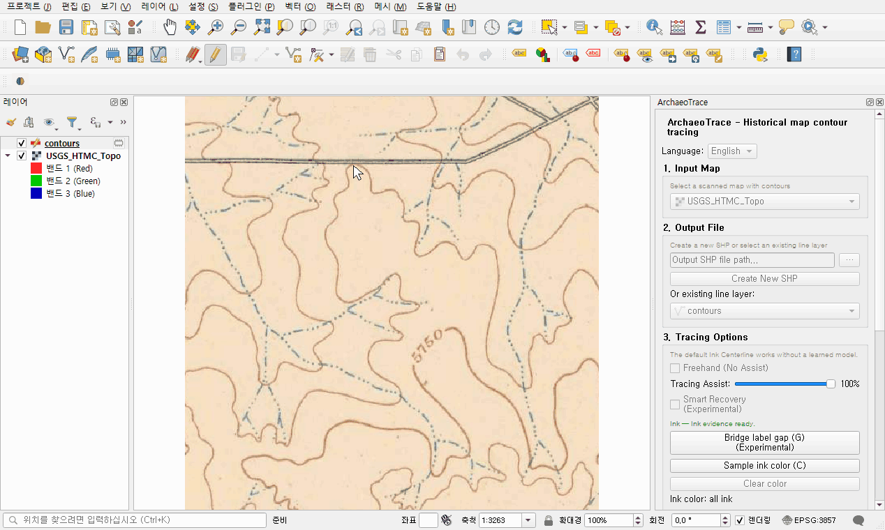
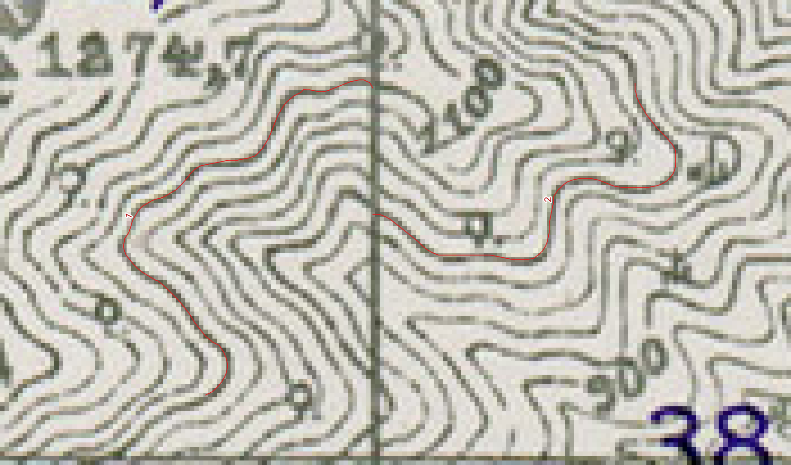

<p align="center">
  
</p>

<h1 align="center">ArchaeoTrace</h1>

<p align="center">
  <strong>고지도 등고선 디지타이징과 과거 지형 복원을 위한 로컬 우선(Local-First) AI 보조 QGIS 플러그인</strong><br>
  <sub>Local-First, Human-in-the-Loop Contour Tracing &amp; Historical Terrain Reconstruction for QGIS (Archaeology · Historical GIS · Geomorphology)</sub>
</p>

<p align="center">
  <a href="https://plugins.qgis.org/plugins/ai_vectorizer/"></a>
  
  <a href="https://github.com/lzpxilfe/AI-Vectorizer-for-Archaeology/actions/workflows/ci.yml"></a>
  <a href="https://doi.org/10.5281/zenodo.24364756"></a>
  
  
  
</p>

<p align="center">
  <strong><a href="README.en.md">English README</a></strong> &middot;
  <a href="#왜-archaeotrace인가">왜 ArchaeoTrace인가</a> &middot;
  <a href="#핵심-기능과-실전-단축키">핵심 기능</a> &middot;
  <a href="#동작-원리">동작 원리</a> &middot;
  <a href="#빠른-시작">빠른 시작</a> &middot;
  <a href="#검증-현황과-한계">검증·한계</a> &middot;
  <a href="#학술-근거-및-인용">학술 근거·인용</a>
</p>

<p align="center">
  
  <br>
  <sub>QGIS에서 직접 실행한 <strong>ArchaeoTrace</strong> 데모 — 기본 <code>Ink Centerline v2</code> + <code>Live-Wire</code>(추가 pip 없음)로 소수의 클릭만으로 구 지형도 등고선(<code>5740</code>)을 추적하고, <code>G</code> 키로 표고 숫자(<code>5750</code>) 끊김 구간을 부드럽게 연결해 저장하는 과정 (USGS HTMC 퍼블릭 도메인 원도)</sub>
</p>

---

## 왜 ArchaeoTrace인가

스캔된 구 지형도·고지도에서 등고선을 벡터화하는 작업은 고고학 지표조사, 역사지리, 지형학, 경관변화 연구에서 가장 큰 시간 병목입니다. 수작업 클릭은 수십 시간이 걸리고, 반대로 클라우드 블랙박스 AI는 **원본 고지도를 외부 서버에 업로드해야 하거나, 글자·기호로 새어 나간 선을 연구자가 제어하기 어렵다**는 한계가 있습니다.

**ArchaeoTrace**는 두 극단 사이에서 연구자가 끝까지 통제권을 유지하는 **Local-First · Human-in-the-Loop** 도구로 설계되었습니다.

| 기존 방식의 한계 | ArchaeoTrace (`0.1.9`)의 해법 |
| --- | --- |
| **순수 수작업 디지타이징** — 수천 개 정점을 일일이 클릭 | 기본 **Ink Centerline v2**(9·15·31px 다중 스케일) + 방향 인식 **Live-Wire**가 인쇄된 등고선 중심을 실시간 추적. **별도 pip 설치 없이 QGIS 기본 NumPy만으로 즉시 동작.** |
| **블랙박스 자동 벡터화** — 글자·얼룩·옆 선으로 새도 교정 불가 | 클릭 전 채택 경로를 그대로 보여 주는 **초록색 WYSIWYG 미리보기**, **`0–100%` 커서-경로 혼합 슬라이더**, **공백 연결(`G`)**, **잉크 색상 지정(`C`)**, **회피 영역(`Alt`+클릭)**, **`Shift`/`Ctrl` 직선**, **끝점 이어 그리기 & `Ctrl+Z` 체크포인트 되돌리기** 제공. |
| **끊기거나 흐릿한 고지도 구간** — 전통 에지 검출기가 멈춤 | 선택적 **Smart Recovery(EfficientSAM-Ti ONNX)** 와 **학습 등고선 보조(ResNet-18 U-Net ONNX)** 를 기본 OFF로 제공. 안전 검사 통과 시에만 채택하며 실패 시 원래 Ink 경로로 fail-closed. |
| **민감·미공개 고지도 외부 유출 우려** | **100% 로컬 처리 & 사용 기록 수집 없음.** 지도와 추적 결과를 원격 추론 서버로 절대 전송하지 않으며, 선택 모델은 고정 크기·SHA-256 검증을 거칩니다. |
| **일회성 연구 스크립트의 불안정성** | **Pure Python 1,246건 + 실제 QGIS 3.44.8 226건 테스트**, **공식 Qt6 검사 0건 경고(46개 파일)**, **QGIS 3.22 / 3.44 / 4.2 실컨테이너 CI 12개 작업 통과**, 한국어/영어 내장 UI. |

<p align="center">
  
  <br>
  <sub>실제 구 지형도 Ink 추적 시범(<a href="docs/REAL_MAP_PILOT_2026-10-19.md">무풍장 1:50,000, U.S. AMS Korea L751 Public Domain</a>) — 밀집 등고선·표고 숫자·격자선이 섞인 스캔 원도 위의 추적 경로 확대 렌더(저장 무결성 시범이며 일반 정확도 점수가 아님)</sub>
</p>

---

## 핵심 기능과 실전 단축키

| 기능 / 모드 | 역할 및 특징 | 추가 의존성 | 상태 |
| --- | --- | --- | --- |
| **Ink Centerline** *(기본)* | 9·15·31px 다중 스케일·RGB 잉크 증거 + bounded Live-Wire 실시간 경로 제안 | 없음 (QGIS 기본 NumPy; SciPy 선택) | 기본값 |
| **Freehand & 보조 강도** | `0–100%` 커서↔제안 경로 실시간 혼합(`0%` = 완전 수동), `Shift`/`Ctrl`+클릭 직선 | 없음 | 기본선 |
| **공백 연결 (`G`)** | 끊긴 등고선·문자 공백의 두 끝점에서 부드러운 3차 Hermite 곡선을 미리 보고 채택 | 없음 | 내장 |
| **선 색상 (`C`) · 회피 (`Alt`+클릭)** | 등고선 고유 잉크색을 표본 추출해 타 색상 선을 억제, 글자·얼룩 영역 회피 지정 | 없음 | 내장 |
| **이어 그리기 & 안전 Undo** | 기존 등고선 끝점에서 기존 고도를 보존한 채 연장; 추적 중 `Ctrl+Z`는 체크포인트만 안전 복귀 | 없음 | 내장 |
| **Smart Recovery · 학습 등고선 보조** | 로컬 ONNX(`EfficientSAM-Ti` / `ResNet-18 U-Net`) 보조 — 안전 Arbiter 통과 시에만 채택 | `onnxruntime` + 명시적 설치 고정-해시 모델 | 선택 (기본 OFF) |
| **Advanced / Legacy 모드** | `LSD`, `HED`, `MobileSAM`, `SAM (ViT-B)`, `Legacy Canny` | OpenCV / PyTorch (선택) | Advanced / Legacy |
| **DEM & Hillshade 생성** | 저장된 등고선과 표고점(Spot Heights)으로 선형 TIN DEM 및 GDAL 음영기복도 생성 | 없음 (QGIS·GDAL 내장) | 실험적 |

---

## 동작 원리

ArchaeoTrace는 AI 마스크나 에지맵을 그대로 정답으로 저장하지 않는 **Champion / Challenger 안전 아키텍처**를 따릅니다.

```text
지오레퍼런싱된 고지도 래스터 (로컬 파일 또는 선택한 WMS/WMTS)
  -> 다중 스케일(9·15·31px) Ink Centerline v2 증거 + 선택적 잉크 색상(C) / 회피 영역(Alt)
  -> 제한 범위(bounded) 방향 인식 Live-Wire [Ink Champion]
  -> (선택, 기본 OFF) Smart Recovery(EfficientSAM-Ti) / 학습 등고선 보조(ONNX) [Challenger]
  -> 안전 Arbiter 통과 시에만 채택 (끝점·우회·강한 Ink 보존·옆 선 전환 검사; 실패 시 Ink 유지)
  -> 실시간 초록색 미리보기 + 0–100% 혼합 + 공백 연결(G) + Shift/Ctrl 직선 + Ctrl+Z 체크포인트
  -> QGIS 편집 버퍼 -> 고도(ELEV) · 표고점(Spot Heights) 저장 (Save Layer Edits)
  -> (선택) 저장된 고도 자료로 선형 TIN DEM & GDAL Hillshade 생성
```

사용자가 눈으로 확인하고 클릭해 채택한 구간만 편집 버퍼에 들어가며, 최종 기록은 QGIS의 `레이어 편집 저장(Save Layer Edits)`에서 확정됩니다. 자세한 아키텍처와 실패 경계는 [`docs/FEATURES_AND_ARCHITECTURE.md`](docs/FEATURES_AND_ARCHITECTURE.md)와 [`docs/INK_V2_SMART_RECOVERY.md`](docs/INK_V2_SMART_RECOVERY.md)를 참고하세요.

---

## 빠른 시작

### 1. 설치 및 언어 선택

- **QGIS 공식 플러그인 저장소**: `플러그인 > 플러그인 관리 및 설치`에서 **실험적 플러그인 표시**를 켜고 `ArchaeoTrace`를 검색해 설치합니다. 후보 ZIP은 `ZIP에서 설치`로 설치할 수 있습니다.
- **릴리스 현황**: 현재 [QGIS 저장소](https://plugins.qgis.org/plugins/ai_vectorizer/version/0.1.8/) 승인 최신판은 **`0.1.8`**(experimental, 2026-11-23)입니다. 게시된 ZIP은 검증한 패키지(SHA-256 `3ecc7fa8…`)와 같으며, 저장소 보안 검사를 모두 통과했습니다(Pass Rate 100%, `Validated (configured)`). DEM 입력 점검과 저장하지 않은 편집의 저장 안내를 더했습니다([릴리스 기록](docs/RELEASE_READINESS_0.1.8.md)). 이전 공개판 `0.1.7`의 검증은 [업로드 ZIP 검증](docs/QT6_UPLOAD_0.1.7.md) · [보안 알림 검토](docs/SECURITY_SCAN_0.1.7.md)에 있습니다. 다음 공개 후보 **`0.1.9`**(지도 시리즈 프리셋, 지도별 프로젝트 기억, 등고선 간격 해발값 제안)는 업로드 전 검증을 마쳤습니다([릴리스 기록](docs/RELEASE_READINESS_0.1.9.md)).
- **한국어 / English 즉시 전환**: 패널 상단 `언어 / Language`에서 선택할 수 있습니다. 최초 실행 시 QGIS 언어를 따르며(한국어 외 환경은 영어), 선택한 언어는 다음 실행에도 유지됩니다.
- **의존성 안내**: 기본 `Freehand`와 `Ink Centerline`은 추가 패키지 없이 바로 동작합니다. 선택 모델 설치 명령과 SHA-256 해시는 ZIP에 동봉된 [한국어 사용 설명서](ai_vectorizer/README.md) 및 [English user guide](ai_vectorizer/README.en.md)에 정리되어 있습니다.

### 2. 등고선 추적 및 DEM 생성

1. 지리 좌표가 설정된 고지도 래스터와 2D 선 출력 레이어를 선택합니다.
2. `Ink Centerline`과 `0–100%` 보조 강도를 정하고 추적을 시작합니다.
3. 초록색 미리보기 경로를 확인하며 클릭해 구간을 채택합니다(`G` 공백 연결, `C` 선 색상 지정, `Alt`+클릭 회피 영역, `Shift`/`Ctrl`+클릭 직선, `Ctrl+Z` 체크포인트 취소).
4. 기존 선의 끝점에서 바로 이어 그릴 수 있으며, `Enter` 또는 우클릭으로 선을 마치고 고도를 입력합니다.
5. QGIS의 `레이어 편집 저장 / Save Layer Edits`로 저장한 뒤, DEM 창에서 **실제 고도 필드**(`elevation` 외 필드명은 직접 선택)와 **미터 단위 투영 좌표계**를 확인해 선형 TIN DEM과 음영기복도를 생성합니다.

---

## 검증 현황과 한계

ArchaeoTrace는 "AI가 완벽하게 복원한다"는 과장을 배제하고, **실제 통과한 검증과 아직 확인되지 않은 한계를 투명하게 공개**합니다.

- **소프트웨어·QGIS 호환 검증 (`0.1.7`)**: Pure Python **1,246건 통과**(subtest 171건), 실제 **QGIS 3.44.8 226건 통과**(실패·오류·건너뜀 0건), 공식 Qt6 검사(QGIS 4.2.1 / Qt 6.9.2) 46개 파일 **경고 0건**, 원격 CI **12개 작업 통과**(QGIS 3.22.16 · 3.44.13 · 4.2.1 실컨테이너 및 Linux/Windows 바이트 동일 ZIP). 세부 수정과 검토 범위는 [0.1.7 검토 기록](docs/RELEASE_REVIEW_2026-11-12.md)에 있습니다.
- **`0.1.9` 후보 검증**: Pure Python **1,271건 통과**, 실제 **QGIS 3.34.4 243건 통과**(17개 모듈, 실패·오류 0건), QGIS 저장소의 보안 검사를 후보 ZIP에 같은 명령으로 재현. 세부 내용은 [0.1.9 릴리스 기록](docs/RELEASE_READINESS_0.1.9.md)에 있습니다.
- **`0.1.8` 검증**: Pure Python **1,252건 통과**, 실제 **QGIS 3.34.4 231건 통과**(15개 모듈, 실패·오류 0건), QGIS 저장소의 보안 검사 다섯 가지를 같은 명령으로 재현해 치명적·경고 0건, 원격 CI 12개 작업 통과. 세부 내용은 [0.1.8 릴리스 기록](docs/RELEASE_READINESS_0.1.8.md)에 있습니다.
- **학습 모델 실험의 투명한 보고**: Colab 3-seed 학습, ONNX 검증, 동일 조건 QGIS 비교를 마쳤으나 일반 글자용 새 모델은 17개 진단 중 양성 13건의 저장 경로를 개선하지 못해 **기존 Korea 모델과 기본 OFF 정책을 유지**했습니다. 후속 단어 그룹 검출 보완도 개선이 없어 채택하지 않았습니다.
  - [학습 및 모델 비교](learning/COLAB_KOREA_TEXT_WEAK_RUN_2026-10-19.md) · [일반 글자 실패 진단](learning/GENERAL_TEXT_FAILURE_DIAGNOSIS_2026-10-19.md) · [후속 검출 실험](learning/WORD_GROUP_EXPERIMENT_2026-11-11.md) · [실제 지도 시범](docs/REAL_MAP_PILOT_2026-10-19.md)
- **학술적 한계**: 사람이 검수한 정답 기준의 정확도와 작업 시간 단축은 아직 정량 검증하지 않았습니다. 생성된 선형 TIN DEM은 입력 등고선 품질에 민감하므로 **확정된 고고학적 정답이 아니라 원본 지도와 대조해 검토할 지형 가설**로 사용하세요. 자동 위상 검사와 불확실성 레이어는 향후 과제입니다.

---

## 데이터 보안 및 로컬 우선 원칙

- 지도 래스터, 벡터 지오메트리, 로컬 추론 결과는 원격 추론 서버로 전송하지 않으며 사용 기록(telemetry)을 수집하지 않습니다.
- 네트워크는 사용자가 선택한 WMS/WMTS 지도를 읽거나 직접 요청한 선택 모델을 내려받을 때만 사용합니다. 다운로드 모델은 고정 바이트 크기와 SHA-256 해시 검증을 통과해야만 활성화됩니다([`SECURITY.md`](SECURITY.md)).

---

## 학술 근거 및 인용

구현된 형태학·그래프 탐색·3차 Hermite 곡선·딥러닝·TIN 지형 보간 기법의 검증된 1차 논문과 DOI는 [`REFERENCES.md`](REFERENCES.md)에 정리되어 있습니다.

연구·교육·문화유산·지형 분석에서 ArchaeoTrace를 사용했다면 [`CITATION.cff`](CITATION.cff)([`.zenodo.json`](.zenodo.json) 연동) 또는 아래 BibTeX로 인용해 주세요.

- 저자: Jinseo Hwang ([ORCID: 0009-0000-8228-4083](https://orcid.org/0009-0000-8228-4083))
- Zenodo DOI: [10.5281/zenodo.24364756](https://doi.org/10.5281/zenodo.24364756) (전체 버전) · [10.5281/zenodo.24526806](https://doi.org/10.5281/zenodo.24526806) (`v0.1.8`)

```bibtex
@software{ArchaeoTrace_Hwang_2026,
  author    = {Hwang, Jinseo},
  title     = {ArchaeoTrace: Local-First AI-Assisted Contour Tracing and Historical Terrain Reconstruction for QGIS},
  year      = {2026},
  publisher = {Zenodo},
  version   = {0.1.8},
  doi       = {10.5281/zenodo.24526806},
  url       = {https://doi.org/10.5281/zenodo.24526806}
}
```

---

## 문서 안내

| 문서 | 내용 |
| --- | --- |
| [`ai_vectorizer/README.md`](ai_vectorizer/README.md) · [`README.en.md`](ai_vectorizer/README.en.md) | ZIP 동봉 한·영 사용 설명서(선택 모델 설치, 해시, 단축키, 문제 해결) |
| [`REFERENCES.md`](REFERENCES.md) | 구현 알고리즘·딥러닝 모델·지형 보간의 검증된 1차 논문 및 DOI |
| [`docs/FEATURES_AND_ARCHITECTURE.md`](docs/FEATURES_AND_ARCHITECTURE.md) | 구현·실험·미구현 경계, 안전 설계, 모듈 구조 |
| [`docs/RELEASE_READINESS_0.1.9.md`](docs/RELEASE_READINESS_0.1.9.md) | `0.1.9` 공개 후보 ZIP 정보, 업로드 전 검증과 업로드 절차 |
| [`docs/RELEASE_READINESS_0.1.8.md`](docs/RELEASE_READINESS_0.1.8.md) | `0.1.8` 공개 ZIP 정보, 업로드 전 검증과 QGIS 게시 기록 |
| [`docs/QT6_UPLOAD_0.1.7.md`](docs/QT6_UPLOAD_0.1.7.md) · [`docs/SECURITY_SCAN_0.1.7.md`](docs/SECURITY_SCAN_0.1.7.md) | `0.1.7` Qt6 업로드 패키지 검증, 공식 보안 스캔 및 예외 목록 감사 |
| [`docs/RELEASE_REVIEW_2026-11-12.md`](docs/RELEASE_REVIEW_2026-11-12.md) | `0.1.7` 설치 후보 검증 및 사용자 흐름 수정 기록 |
| [`benchmarks/README.md`](benchmarks/README.md) · [`learning/README.md`](learning/README.md) | 재현 벤치마크 하네스 및 Colab 학습·실험 기록 |
| [`ROADMAP.md`](ROADMAP.md) · [`CHANGELOG.md`](CHANGELOG.md) | 개발 로드맵, 의도적 비목표, 버전별 변경 이력 |
| [`CONTRIBUTING.md`](CONTRIBUTING.md) · [`SECURITY.md`](SECURITY.md) · [`LICENSE`](LICENSE) | 기여 규칙·결정적 패키징, 보안 정책, GNU GPL v2.0 라이선스 |
