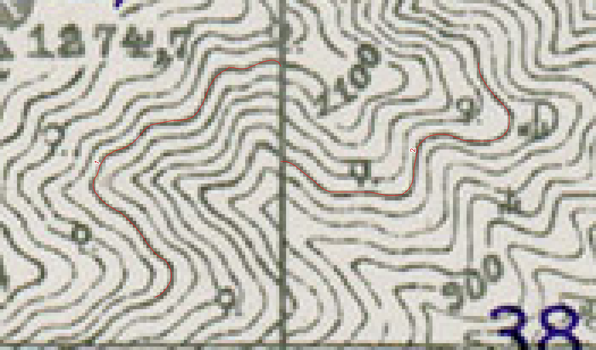

# 실제 지도 Ink 추적 시범 — 2026-10-19

무풍장 고지도의 가시 등고선 **3구간을 열린 선으로 추적해 QGIS 파일로 저장했다.**
이는 도구를 실제 지도에 적용하고 저장 무결성을 확인한 작은 시범이다.
Colab에서 재학습한 모델의 성능 향상이나 지도 전체 벡터화를 입증한 결과는 아니다.

빨간 선과 번호는 저장한 3개 선 중 **1·2번의 두 구간**이다. QGIS 파일 API로
렌더링한 확대 그림이며, GUI 도구 조작을 촬영한 화면은 아니다.

## 지도와 좌표

- 원도: U.S. Army Map Service, Korea 1:50,000 Series L751,
  **Mupungjang 6721 I**, 흥덕산(HUNG DOK SAN) 주변.
- 스캔 제공: [University of Texas Libraries 원본 지도](https://maps.lib.utexas.edu/maps/ams/korea_50k/txu-pclmaps-oclc-6612107-mupungjang-6721-i.jpg).
  출처 기록상 미국 정부 저작물의 Public Domain 자료이며,
  [UT Libraries 지도 이용·권리 안내](https://maps.lib.utexas.edu/maps/faq.html)를 함께 참조한다.
- 원본: 4717×4217px. 원본 SHA-256:
  `f9fd5d50d7f1081f1be1d5e0989f15225af8e217542630cb08101b40467e0fac`.
- 사용 영역: 원본 픽셀의 `[x, y, width, height] = [1120, 2150, 1024, 1024]`.
  원본 RGB를 재표본화하지 않고 잘랐다.
- 원본에 지리 좌표가 없어 사용자 정의 **pixel 단위**로만 작업했다. ROI 내부의
  열·행 `(c, r)`은 `(c+0.5, 1024-r-0.5)`로 저장했으며, EPSG·미터 좌표가 아니다.

## 실행과 확인

에이전트가 원본의 읽을 수 있는 선을 검토해 앵커 22개를 정하고, 현재 제품의
**Ink/Live-Wire 커널 API를 강도 100%로 19구간에 적용**했다. 학습 모델과
Smart Recovery는 사용하지 않았다. 원본과 경로를 대조한 뒤 공식 QGIS 데이터·파일
API로 저장했다. 이번 지도 시범에서 제품 코드·모델·기본 설정은 바꾸지 않았다.

GeoPackage에는 열린 선 3개, 정점 106·99·100개(총 305개)가 들어 있다.
별도 QGIS 프로세스에서 다시 열어 선의 유효성과 생성 경로 대비 저장 좌표 오차
0px를 확인했다. 최종 프로젝트를 실제 QGIS에서도 열어 원본 위의 빨간 선 3개가
표시되는 것을 확인했다. **좌표 일치는 저장 무결성 검사이며 정확도 점수가 아니다.**

처음 GUI에서 Ink 도구를 켠 뒤 Python 콘솔 입력 중 Qt/QScintilla 자동완성 처리
스택에서 네이티브 충돌이 발생했다. 근본 원인은 미확정이며 Ink 커널의 실패로
확인된 것은 아니다. 충돌 전 GUI로 저장한 선은 0개다. 이후 커널/API로 파일 생성을
완료했으므로 연속 GUI 추적·Undo 동작까지 검증했다고 주장하지 않는다.
최종 GUI에는 사용자 정의 픽셀 CRS 간 변환 경고도 남았고, 그 원인 역시 미확정이다.

## 해석 범위

지도 범례의 등고선 간격은 20m지만 각 선의 고도를 확정하지 않아 **고도는 모두
NULL**이다. 삼각점·표고점 숫자를 등고선 고도로 대입하지 않았으며 DEM도 만들지
않았다. 다른 지리 레이어와 사용하려면 별도로 지오리퍼런싱해야 한다.

에이전트 검토 초안(`agent_draft`)이며 사람의 수동 검수·승인은 없다
(`human_reviewed=false`, `training_eligible=false`). 글자에 가려진 곡선은 임의로
복원하거나 정답으로 채점하지 않았다. 기존 validation 도엽을 사용했으므로 독립
새 지도 평가가 아니며, 공식 Calibration/Holdout은 열지 않았다. 이 사례는
일반 글자 공백 성능이나 독립 정답에 대한 정확도 개선의 근거로 사용하지 않는다.

공개 그림은 보존한 `map-peak-detail.png`와 바이트가 같으며 SHA-256은
`9ef84956f9ab6b1131f88d5656b71d7ba1743113318d6631e1a1096c7257287e`다.
출처·실행 범위는 보존한 `README_KO.txt`, `work-state.json`,
`export-verification.json`, `gui-final-view.json` 기록을 대조했다.
원본 스캔·모델·개인 경로가 포함된 실행 원자료는 이 문서에 첨부하지 않는다.
