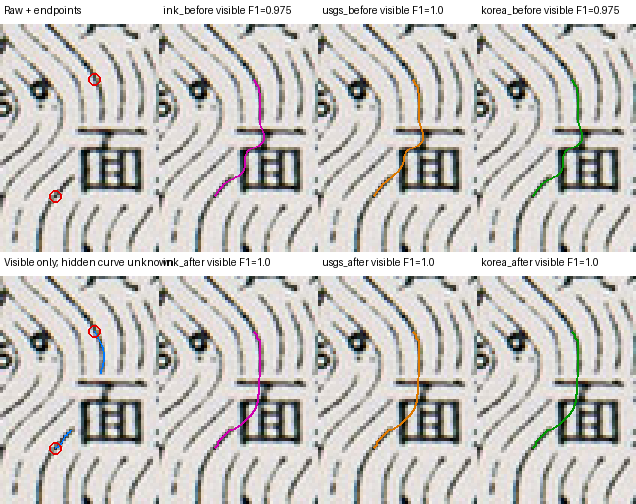

# 한국 지도 일반 글자 공백 점검 — 2026-10-16

숫자가 아닌 글자 때문에 끊긴 등고선을 자동으로 연결하는 개발 점검이다.
출력을 보기 전에 두 원본 사례의 클릭·가시선·옆 선 표본을 동결했다.
파란 `a`는 기존 경로도 이미 좋았으며, 검은 한자 `面`도 기존 경로가 옆 등고선으로
넘어갔다고 판정할 근거는 없었다. 따라서 새 기능의 검출·연결 품질과 기존 경로 보존을
구분해 확인한다. 숨은 곡선의 실제 모양을 정답으로 만들거나 채점하지 않는다.

## 자료 범위와 출처

원본 픽셀을 그대로 자른 `512×512` Byte RGB 창 **21개**를 원본 검토 후보로 준비했다.
이 수량은 검수 정답, 학습 표본 또는 성공 사례 21개라는 뜻이 아니다.

| 도엽 | 창 수 | 이번 점검에서의 역할 |
| --- | ---: | --- |
| Namwon 6620 II | 11 | 기존 validation 도엽의 아직 경로를 실행하지 않은 다른 위치 |
| Mupungjang 6721 I | 4 | 기존 validation 도엽의 아직 경로를 실행하지 않은 다른 위치 |
| Yongdam 6621 I | 3 | 원래 16개 분할에 속하지 않은 추가 개발 도엽 |
| Odae-san 6927 III | 3 | 원래 16개 분할에 속하지 않은 추가 개발 도엽 |

앞의 15개는 이전에 원본만 검토할 수 있었던 창이며 기존 24개 크롭과 0픽셀 겹친다.
앞선 작업에서 이미 경로를 실행한 새 창 5개는 제외했다. 추가한 두 도엽은 원래
16개 family와 겹치지 않음을 메타데이터로 확인한 뒤 원본을 열었다. 두 도엽 모두
이전에 축소 원본 자동 스크리닝을 거친 캐시다. 처음 보는 지도라고 부르지 않는다.
추가 창 여섯 개도 이번 점검 전 모델·경로 출력은 알려져 있지 않으며 서로 겹치지 않는다.
Calibration·Holdout 원본은 열지 않았다. 추가 도엽의 역할은 개발이며 공식 Holdout이 아니다.

[공개 크롭 인덱스](data/korea-general-text-crop-index-v1.json)에 원본 URL, 크롭 좌표,
원본·PNG·픽셀 해시와 검토 기록 해시를 남겼다. 확대·축소·재투영은 하지 않았다.
원본은 지리 참조가 없는 스캔이므로 지도상의 실제 위치 정확도를 검증하지 않는다.
발행자는 U.S. Army Map Service, 스캔 출처는 University of Texas Libraries다.
권리 기록은 미국 정부 저작물의 Public domain으로 분류하며
[도서관의 권리 안내](https://maps.lib.utexas.edu/maps/faq.html) 스냅숏을 결속한다.

| 동결·출처 기록 | SHA-256 |
| --- | --- |
| 기존 도엽 15개 창의 원본 인벤토리 | `678ee656a6237d745c0f74f3e7075a08cf716994f1c8f17a909ccd29d42f1382` |
| 기존 도엽 진단 매니페스트 | `bfedb61aff47a0314a14460198cabff0531ad730d69d076c552718d9ccd7e739` |
| 추가 도엽 여섯 창 매니페스트 | `311e8a5d2b5373deb8e48a84849de3db0245c3c752f22759dc6933b5cc9eb6eb` |
| 추가 도엽의 독립 원본·공간 검사 | `6c51d830321af9ee8f4d2fe155780579a858b916b853870a762f7623ad4eb1f8` |
| 권리 스냅숏 | `cd70e60055691a77f762657b712cf1f8569837e0941227e085321d8f7dd86659` |

## 출력 전 동결한 두 사례

두 agent가 원본 전체 문맥, 확대본, 정확한 RGB 좌표와 선을 가로지르는 밝기 프로필을
따로 확인했다. 클릭·가시선·옆 선 표본은 모두 원본의 어두운 픽셀 대비 검사를 통과했다.
이 검사는 종이 위 좌표를 거르는 절차이며 선 소속을 자동 증명하지 않는다.
사람 승인 수는 **0**이다. 초기의 대략적 종이 좌표와 잘못 짚은 옆 선은 출력 전에
버렸으며 동결 참조에 넣지 않았다. 출력 후 참조나 unknown 상자를 고쳐 점수를 맞추지 않는다.

| 사례 | 원본 크롭 XYWH | 실제 클릭 RC `(행, 열)` | 수동 가시 지지점 XY | unknown XYXY |
| --- | --- | --- | --- | --- |
| 파란 Latin `a`, Hadugil-ri | `[1280,192,512,512]` | `(258,137)` → `(287,152)` | `(138,266)` ↔ `(140,277)` | `[137,267,143,277]` |
| 검은 한자 `面`, PUGWI-MYON | `[2200,2700,512,512]` | `(140,314)` → `(179,301)` | `(316,154)` ↔ `(306,173)` | `[306,155,319,173]` |

파란 `a`는 짧은 덧인쇄 획을 사이에 둔 얇은 선이다. 검은 `面`은 글자 주변의 흰
인쇄 여유가 등고선을 실제로 끊는다. 정상 선의 순서와 굵기를 확인해 동쪽 봉우리
사면의 굵은 위쪽 팔이 글자 아래 왼쪽 굵은 팔로 이어진다고 판정했다. 아래 오른쪽
얇은 팔은 다른 등고선이다. 수동 지지점은 계산된 중심선 끝점의 정답이 아니다.

각 양성에 대해 다른 선 위의 클릭을 하나씩 별도 동결했다. 파란 사례의 다른 선
클릭은 RC `(285,156)`, 검은 사례는 `(188,305)`다. 이 두 음성은 잘못된 **자동 연결
후보 쌍의 제외**를 확인한다. 서로 다른 선을 클릭한 경로의 정확도를 채점하거나,
그런 클릭에서 일반 경로가 없으리라고 요구하지 않는다.

| 저장소 fixture·독립 검토 | SHA-256 |
| --- | --- |
| [파란 글자 v1](data/korea-general-text-gap-cases-v1.json), 양성 1·음성 1 | `46d2b13c7b3c4f88a58c909641ecce06c92790b4aab7514dfa062bd2a887bf05` |
| 파란 글자 독립 원본 검토 | `3a9d7384c3f4bab5d79329e7ce8d0b41b62ec83a1240050b2a37f5603b082659` |
| [검은 글자 v2](data/korea-general-text-gap-cases-v2.json), 양성 1·음성 1 | `aba0da201662a9341c8a2777a046585f361abdbc1f894c0fe3656372d3cf0e49` |
| 검은 글자 독립 원본 검토 v2 | `235ed6b8f45f238b412503225f02233ac5e25d420b82f87c2fe1f442271288bb` |

보이는 두 팔만 따로 참조한다. 숨은 선을 임의 보간한 정답은 없다. 표본 옆 선과의
연속 선분 최소 거리·1px 접촉은 unknown 상자 안에서도 별도로 확인한다. 표본은
주변 모든 선을 포괄하지 않으므로 접촉이 없다는 결과를 모든 옆 선 이동의 부재로
일반화하지 않는다. 다른 한자·지명 후보는 여러 대응이 가능해 양성으로 강제하지 않았다.

## 기존 동작과 원인 분석

기준은 `main`의 `65cc80a`와 그때 보존한 ZIP이다. 같은 실제 QGIS CPU 환경에서
Ink·USGS guide·한국 guide의 클릭·문맥·학습 지지·회피 설정을 맞춰 비교한다.
아래 경로 비교에서는 모델·학습 가중치를 바꾸지 않는다. 일반 글자 재학습은 별도
실험으로 준비하며 이 비교의 개선을 재학습 효과로 설명하지 않는다.

파란 `a`는 기준 세 방법 모두 가시 F1@2px가 이미 1.000이었다. 기존 경로가 글자
획과 이어진 원본 증거를 따라가는 경우여서, 자동 끝점을 새로 만들지 않는 제한이
제대로 작동했다. 이 사례를 새 기능이 개선한 성공으로 세지 않는다.

검은 `面`은 기준 Ink·한국 guide의 가시 F1@2px가 0.975, USGS guide는 1.000이었다.
기준 경로의 frozen 표본 옆 선 1px 접촉도 없었다. 원본의 두 끝점은 실제 QGIS의
320픽셀 추적 창에서 확인됐지만 기존 숫자 검출 제안은 없었다. 계산된 실제 끝점
XY `(316,153)`·`(307,173)`은 출력 후 원인 분석 결과이며 동결 수동 지지점을 덮어쓰지 않는다.

작은 획의 EDT 반경은 1과 √2처럼 픽셀 방향에 따라 양자화된다. 글자 제안에 기존
굵기 점수를 그대로 적용하면 이 차이가 실제 굵기 차이처럼 후보 순위에 작용할 수 있다.
글자 경로에 한해 이 작은 반경의 점수 불확실성을 다루고, 원본 팔의 실제 분기를
거친 연결은 거부하는 방식을 구현·검토한다. 기존 숫자 경로의 점수·우선권·예산과
원본의 진짜 끝점 제한은 유지한다. 수동 面 좌표를 제품 입력이나 검출 조건으로 넣지 않는다.

새 글자 제안은 작은 성분의 정렬·분기 형태, 또는 두 내부 공간과 독립 획의 구조를
사용한다. OCR 결과가 아니며 글자 후보만 제안한다. 실제 잉크 core와 문맥 마스크를
구분해 글자 내부 공간·글자 사이의 보이는 다른 선을 지우지 않는다. 연결은 원래
중심선에서 이미 끝나는 두 팔, 상호 유일성, 굵기·곡률·다른 선 접촉 검사를 통과해야 한다.

검출만 추가한 첫 패키지는 연결 후보가 있어도 기존 경로를 보존해 표시 결과가
그대로였다. 기존 보존 검사는 글자 안의 곡선을 정답으로 가정하지 않기 때문이다.
후속 판정은 이 검사를 통과한 **일반 글자**에만 적용한다. 선택한 글자의 실제 잉크를
따르는 연속 구간이 8px 이상이고 후보의 두 배 이상이며, 연속·전체 잉크 접촉과
공백 경로 길이가 각각 4px 이상 줄 때만 새 곡선을 우선한다. 전체 접촉도 후보의
1.5배 이상이어야 한다. 같은 원본 끝점·가시 팔·분기·표시 후 접촉 검사는 계속 필요하다.
균일한 원본 거리 표본을 사용하며 픽셀 계단 때문에 부풀려지는 회전각은 사용하지 않는다.
종이 위에서 굽은 선, 짧은 횡단, 다른 글자 잉크, 비슷하게 좋은 기존 선은 보존한다.

수동 영역을 사용한 중간 진단에서는 굵기 점수만 바꾸면 올바른 공백 뒤에 먼 격자
교차점을 돌아 옆 선에 도달할 수 있었다. 이 결과는 성공으로 채택하지 않았다.
새 글자 후보의 보이는 prefix·suffix가 실제 분기점을 지나면 거부한다. 기존 숫자의
연결 점수와 분기 정책을 전역으로 바꾸지 않는다.

## 최종 실측과 회귀 검사

실제 QGIS 3.44.8, Mac M4·32GB CPU, ONNX Runtime 1.31.0 CPUExecutionProvider를
사용했다. 같은 정수 픽셀 중심 마우스 입력, 320픽셀 문맥, 100% 보조율, 격자 회피와
자동 공백 연결 ON을 두 버전에 적용했다. 학습 지지는 0.8, 미보정 회피 비용은 0이다.

| 사례·방법 | 가시 F1@2px 이전 → 이후 | 가시 p95 이전 → 이후 | 표본 옆 선 최소 거리·1px 접촉 | 후보·저장 경로 |
| --- | --- | --- | --- | --- |
| 파란 `a` · 세 방법 | 1.000 → 1.000 | 0.314 → 0.314px | 최소 4.243px, 접촉 없음 | 기존 좌표 그대로 |
| 검은 `面` · Ink | 0.975 → 1.000 | 1.668 → 1.000px | 4.652 → 5.821px, 접촉 없음 | 자동 글자 연결 |
| 검은 `面` · USGS guide | 1.000 → 1.000 | 1.000 → 1.000px | 4.652 → 5.821px, 접촉 없음 | 자동 글자 연결 |
| 검은 `面` · 한국 guide | 0.975 → 1.000 | 1.651 → 1.000px | 4.652 → 5.821px, 접촉 없음 | 자동 글자 연결 |
| 각 글자의 다른 선 음성 쌍 | 정확도 비채점 | 비채점 | 표본 1px 접촉 없음 | 세 방법 모두 잘못된 자동 후보 없음 |

기존 연속선 v3 7건, 숫자 공백 v4 5건, 새 `300` 한 건을 각 세 방법으로 다시
실행했다. 기존 13건의 **39개** 저장 좌표 쌍과 파란 글자 양성·음성의 **6개** 쌍,
합계 **45개가 모두 동일**했다. 검은 글자 음성의 세 경로도 기존 좌표를 유지했다.
검은 글자 양성 세 경로만 바뀌었다. 총 17건 × 세 방법의 51개 버전 비교다.
미리보기·저장 좌표와 한 번의 Undo를 확인했고 원본 캐시 증거도 버전 간 동일했다.

[기계 판독 비교 기록](data/general-text-gap-check-2026-10-16.json)에 fixture·모델·출력·
원본 증거 해시와 경로 보존 결과를 결속한다. 일반 클릭·빠른 클릭·취소·0%·레이어
제거·dispose·늦은 결과와 저장·Undo는 최종 ZIP의 실제 QGIS suite **177건**이 통과했다.
import smoke, 일회용 profile 제거와 결정적 package check도 통과했다.
전체 pure suite는 **1,182 통과·선택 런타임 159 skip·171 subtest 통과**다.
별도 학습 환경에서는 실제 PyTorch 학습·정확한 재개·ONNX 내보내기와 새 노트북을
포함한 **26건**이 skip 없이 통과했다. 새 학습 가중치는 이 경로 비교에 사용하지 않았다.

| 실행 산출물 | SHA-256 |
| --- | --- |
| 기준 `65cc80a` ZIP | `68ac1c6dfe7ac5c16c060d522fa27f4c59c5c4c92b405c4cd923e8a4c1803667` |
| 실제 버전 비교 ZIP | `f799971a4b6f9944aa2a04eacd83e40507230e90dba467782e720b5313fcb154` |
| 최종 개발 ZIP | `1966cecdee2733c6d57cfaff702f5f13a275da7e6504b67c0e546c7f9064d359` |
| `面` 실제 QGIS 비교 결과 | `ca1e2e59a6b13c0abfa07b9cef3a45e643ed25ca72a55077d51e83b6c111cc54` |

최종 ZIP과 버전 비교 ZIP의 모든 제품 Python 바이트는 동일하다. 차이는 offline
README 한 파일이며 최종 ZIP을 별도로 import·QGIS suite·package 검사했다.
원본·동결 참조·실패 출력·거부한 prototype은 작업 자료
`work/unseen-korea-text-gap/`에서 보존한다. CI는 `main` 커밋에 결속된 실행을 확인한다.

공개 기록은 공개 지도에서 파생된 좌표·해시·점검 결과만 담는다. 개인 작업 경로,
QGIS 사용자 profile, Drive 경로·인증 정보는 넣지 않는다. 단어 전체가 가린 긴 공백,
분기·융합으로 끝점을 확정할 수 없는 선, 한국 지도 전체 성능은 아직 검증 범위 밖이다.
