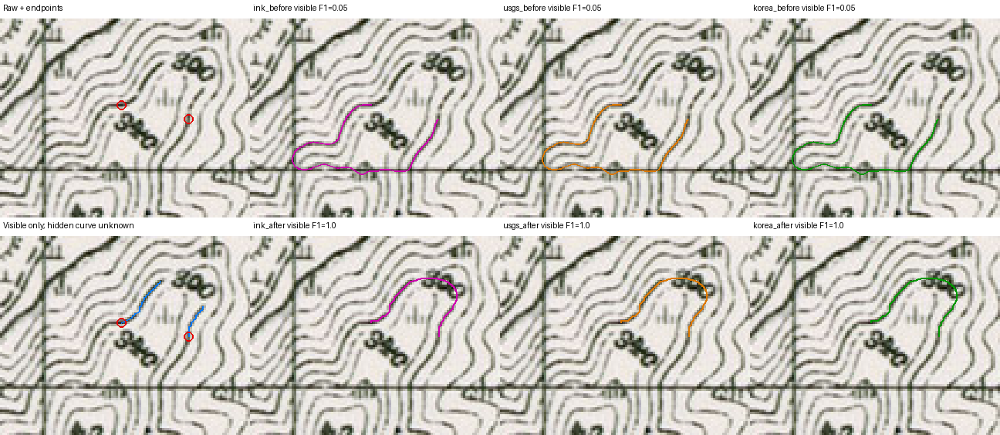

# 새 한국 지도 영역의 숫자 공백 점검 — 2026-10-16

새로 자른 지도 영역에서 숫자 공백과 이웃 등고선 접촉을 점검한다. 첫 비교의
참조 좌표에 오류가 있어 그 성능 판정을 철회했고, 별도의 원본 검토를 거쳐 새
`300` 사례 1개를 출력 확인 전에 동결했다. 검출 누락과 분기 경로의 우선권을 고쳐
실제 QGIS에서 세 방법의 가시 F1@2px를 **0.050→1.000**으로 개선했고, 기존 36개
저장 경로는 유지했다. 숨은 곡선이나 한국 지도 전체 성능을 검증한 결과는 아니다.

## 자료의 범위와 출처

여기서 새 영역은 **공간적으로 겹치지 않는 크롭**이라는 뜻이다. 이미 개발에 사용한
한국 validation 도엽의 다른 위치이므로 새 도엽, 독립 Holdout 또는 한국 지도 전체에
대한 일반화 평가가 아니다. Calibration·Holdout 자료는 열지 않았다.

| 원본 | 발행·스캔 출처 | 새 크롭 수 |
| --- | --- | ---: |
| Namwon 6620 II (`kr-09`) | U.S. Army Map Service / University of Texas Libraries | 12 |
| Mupungjang 6721 I (`kr-10`) | U.S. Army Map Service / University of Texas Libraries | 8 |

총 20개는 원본 픽셀을 그대로 자른 `512×512` Byte RGB PNG다. 크롭 과정에서 확대·축소나
재투영을 하지 않았고, 원본은 지리 참조가 없는 스캔이다. 기존 두 도엽의 24개 크롭과
새 20개 사이, 새 크롭 상호 간의 겹침은 각각 **0픽셀**이다. 최초 16개 뒤에 `kr-09`
4개를 추가했으며, 추가 창도 그 창의 모델·경로 출력을 보기 전에 좌표를 고정했다.
이 수량을 검수 정답 20개 또는 학습 표본 20개로 해석해서는 안 된다.

[공개 크롭 인덱스](data/korea-unseen-native-crop-index-v1.json)와 작업 자료의
`work/unseen-korea-gap/crop-inventory-v2.json`에 원본 URL·파일 해시·
크롭 좌표·이미지 해시·권리 스냅숏을 기록했다. 권리 기록은 미국 정부 저작물의
Public domain으로 분류하고, University of Texas Libraries를 스캔 출처로 명시한다.
두 원본은 [Namwon 스캔](https://maps.lib.utexas.edu/maps/ams/korea_50k/txu-pclmaps-oclc-6612107-namwon-6620-ii.jpg)과
[Mupungjang 스캔](https://maps.lib.utexas.edu/maps/ams/korea_50k/txu-pclmaps-oclc-6612107-mupungjang-6721-i.jpg)이다.

| 보존 자료 | SHA-256 |
| --- | --- |
| `crop-inventory-v2.json` | `e5ea10be97442f148f22c0601604d12e26ba44bb0562d7c8c8d5564ee58f2b71` |
| Namwon 원본 JPEG | `8086da5974f7ccde7bdc941faff351b222958a0df18f0dd0fe0db4d55e4bbcdf` |
| Mupungjang 원본 JPEG | `f9fd5d50d7f1081f1be1d5e0989f15225af8e217542630cb08101b40467e0fac` |
| 권리 스냅숏 `pcl-ams-korea-rights.txt` | `cd70e60055691a77f762657b712cf1f8569837e0941227e085321d8f7dd86659` |

## 첫 7건의 참조 감사와 철회

첫 [v1 사례](data/korea-unseen-label-gap-cases-v1.json)로 실제 비교를 실행한 뒤,
원본의 정확한 RGB 좌표와 선 소속을 다시 확인했다. 검은 픽셀 위의 클릭만으로도
동일 등고선임을 증명할 수 없었고, 일부 보이는 선 참조는 종이 위에 놓여 있었다.
이에 따라 **6건의 정확도·옆 선 이동 판정을 철회**했다. 파란 지명 1건은 처음부터
판단 불가능한 비채점 사례로 유지한다.

| v1 사례 | 철회·제외 이유 |
| --- | --- |
| `kr-09` 세로 숫자 공백 양성 | 글자에 이어진 획과 가까운 다른 선의 대응이 불확실하다. |
| `kr-09` 세로 숫자 옆 선 음성 | 대응 양성의 선 소속이 미확정이므로 음성 판정도 검증 근거가 아니다. |
| `kr-10` 대각선 `600` | 가시선 좌표 일부가 어두운 선 중심에서 벗어나거나 종이 위에 있다. |
| `kr-10` 대각선 `700` | 왼쪽 클릭이 주장한 굵은 선 대신 얇은 옆 선을 골랐고, 다른 클릭·참조에도 종이 좌표가 있다. |
| `kr-10` 아래쪽 `800` | 여러 가시선 참조가 종이 또는 선 사이에 있어 정확한 대응을 보장하지 못한다. |
| `kr-10` `700` 안쪽 옆 선 음성 | 잘못된 양성의 선 소속 해석에 의존했다. |
| 파란 지명 | 선의 대응을 확정하지 못한 비채점 실행 진단이다. 글자 공백 해결의 근거로 사용하지 않는다. |

[철회 기록](data/korea-unseen-label-gap-case-audit-v1.json)에 사례별 이유를 남겼다.
v1 원본 바이트와 첫 실행의 `result.json`, `scores.json`, 캐시·이미지·진단 자료는
감사 증거로 보존한다. 출력에 맞춰 v1 좌표나 unknown 영역을 수정하지 않는다.
철회 점수를 성능 목표로 사용하거나, 출력 후 고른 좌표를 사전 동결 평가로 부르지 않는다.

- v1 원본 SHA-256: `695dab7ef0cd0950812b94d198d0151f8a9575d07e69bba25edce41586dfe28a`
- 작업 자료의 `post-output-source-audit-v1.json` SHA-256:
  `88d462a7c974bb390f7b203cbf291db2ed183330d1e091dfab8bcb5221a909f1`

`700`의 붙은 숫자 획을 더 다루는 국소 prototype도 검토했으나, 원본의 어두운
끝점이라는 사실만으로 같은 등고선임을 확정하지 못했다. 시험 곡선은 다른 보이는
선과 접촉해 기존 검사에서 거부되었다. 이 실험을 `700` 해결로 발표하지 않으며,
검출 범위나 원본 끝점 제한을 완화하는 제품 변경으로 반영하지 않는다.

## 별도로 사전 동결한 `300` 한 건

[v2 사례](data/korea-unseen-label-gap-cases-v2.json)는 앞서 경로를 실행하지 않은
`kr-10-unseen-native-06`에서 골랐다. 두 agent가 원본 픽셀과 확대본을 독립 검토했다.
이 크롭의 모델 점수맵·중심선·경로 출력을 보기 전에 클릭, 보이는 선, 다른 선의
표본과 unknown 영역을 고정했다. 사람 승인 수는 **0**이며 공식 검증 자료가 아니다.

| 항목 | 동결 값 |
| --- | --- |
| 사례 ID | `kr10-second06-index-300` |
| 원본 크롭 XYWH | `[3328, 192, 512, 512]` |
| 클릭 RC `(행, 열)` | `(314,408)` → `(320,437)` |
| 보이는 공백 지지점 XY | `(425,296)`, `(443,307)` |
| unknown 영역 XY | `[426,291,449,307]` |
| 이미지 SHA-256 | `a1e7eca8e8b5071f288bd65408f46b66b10f31f4a3cf202dc3dd60362ed135f4` |

바깥 `280`, 중간 `300`, 안쪽 `320` 표기와 보이는 선의 순서를 함께 확인해 양쪽
팔의 대응을 검토했다. 명시한 클릭·가시선·다른 선의 **고유 좌표 45개**는 원본 RGB의
어두운 인쇄 획 대비 검사를 모두 통과했다. 별도 검토는 중심 좌표 10개에서 선을
가로지르는 원본 밝기 프로필도 확인했다. 이 검사는 종이 위 좌표를 거르는 절차이며
그 자체가 선 소속이나 모델 성능을 증명하지 않는다.

보이는 두 팔만 따로 참조했으며 숨은 연결 곡선은 정답으로 그리지 않았다.
공백 지지점은 수동 관찰 좌표로, 계산된 원본 중심선 끝점의 정답이 아니다.
가장 가까운 표본 옆 선과의 간격은 왼쪽에서 약 **4.5px**라서 모든 구간이 6px 이상
떨어진 사례도 아니다. 다른 선 표본은 완전한 의미 정답이 아니므로 표본 접촉이
없어도 모든 옆 선 이동이 없다고 단정할 수 없다. 추가 후보의 대응이 불확실해
두 번째 양성이나 음성 사례를 억지로 채우지 않았다.

| 사전 동결 자료 | SHA-256 |
| --- | --- |
| 저장소의 v2 비교 fixture | `1284586b3d66ddb3fc6be08e737767811d4115f115d8d2f3a9f6a2e29c0000ac` |
| `review-second-prospective-kr10.json` | `1ad98e215d0ebe9008c10fdfc06d5f0badfdc43e465024ef1b9a5553c6923c43` |
| 독립 원본 검토 `second-crossreview-kr10-06.json` | `0aca40ea7eec540ee7cb9790c2691b8dd404ecbaec9fb9a564dfe2f607b8ecf9` |
| 원본 제안 `proposed-kr10-06-case.json` | `e6eaf83817029c733b8da55b79dad348518e1d45a5f033be9f280cabfad72995` |
| 원본 픽셀 검사 | `04e11341f8c1c8f6b95055d33c39f7ca5334085b4f1522f14043e587c485e25b` |

## 실패 원인과 수정 범위

동결한 `300`에서 기존 세 방법은 같은 124개 저장 좌표를 만들었다. 클릭과 저장
양끝 오차는 0이었다. 원본 중심선 경로는 144.539px로, 숫자 쪽 팔 대신 반대쪽으로
출발해 격자 근처의 분기 세 곳을 돌아왔다. 원본에 연결되어 있다는 이유로 이 경로가
우선됐으며, 관측 연결을 전부 끈 픽셀 경로도 아래쪽 `320`으로 향해 실패했다.
따라서 전역 우회 비율 제한이나 관측 연결 끄기를 해결책으로 사용하지 않았다.

숫자의 작은 내부 공간 세 개가 하나의 짧은 인쇄 성분에 붙어 있었고, 두 공간은
둥글어서 기존의 서로 다른 길쭉한 내부 공간 두 개 조건에 맞지 않았다. 새 검출은
기존 제안의 마스크·우선순위를 유지하면서, 한 작은 성분 안에 3–6개의 내부 공간이
좁은 기준선에 배열된 경우를 추가한다. 내부 공간 후보 512개와 제안 64개 상한,
작업 중 취소, 원본 픽셀·임계값·문자 여유 폭을 유지한다. 넓은 격자나 단독 `8/B`의
두 공간만으로는 이 경로가 활성화되지 않는다. OCR이나 새 모델은 사용하지 않는다.

실제 연결 후보는 원본의 진짜 끝점 XY `(426,296)` ↔ `(443,307)`을 선택한다.
이는 출력 후 원인을 분석하며 확인한 계산 결과이며, 출력 전 수동 지지점 `(425,296)`을
새 좌표로 덮어쓴 것이 아니다. 가려진 선의 정답도 만들지 않았다.

마스크 밖의 연결이 **실제 분기점을 거치고**, 별도로 채택 가능한 공백 후보의 양쪽
원본 팔이 **분기 없이 실제 끝점까지 이어질 때만** 기존의 무조건 우선권을 해제한다.
온전한 분기 없는 U자는 계속 우선한다. 8방향 그래프가 T자 한 픽셀을 대각선으로
건너뛰는 경우도 그 대각선의 실제 공통 직교 잉크를 확인한다. 주변 전체를 부풀려
분기로 취급하지 않는다. 실제 끝점, 상호 유일성, 옆 선·표시 후 접촉 검사는 유지한다.
추가 degree 배열은 worker에서 준비하고 읽기 전용으로 보관한다.

비교 도구도 실패 경로 전체가 그림에 들어오도록 고쳤다. 의도한 참조 부근만 잘라
격자 쪽 우회를 숨기지 않는다. 알려진 다른 선의 표본과 실제 저장 경로의 1px 접촉은
unknown 상자 안에서도 별도 기록한다. 이는 표본에 대한 검사이며 모든 이웃 선의
정체성을 판정하는 것은 아니다. `scripts/audit_visual_controls.py`는 원본의 대비만으로
종이 위 검수점을 표시하고, 선 소속이 증명되었다는 상태는 반환하지 않는다.

## 실제 비교 결과

기존 `42c030c`의 ZIP과 최종 개발 ZIP을 각각 임시 profile에 설치했다. QGIS
3.44.8-Solothurn, Mac M4·32GB CPU, ONNX Runtime 1.31.0의 CPUExecutionProvider로
같은 스캔·문맥·실제 마우스 클릭을 사용했다. 두 버전 모두 격자 회피와 자동 숫자
연결을 켰다. 미보정 모델의 회피 비용은 0이며 모델·보조율·학습 지지는 동일하다.
모델·데이터·학습 가중치는 바꾸지 않았다.

| 방법 | 가시 F1@2px 이전 → 이후 | 가시 p95 거리 이전 → 이후 | 자동 공백 후보 |
| --- | --- | --- | --- |
| Ink | 0.050 → 1.000 | 41.176 → 0.696px | 없음 → 채택 |
| USGS guide | 0.050 → 1.000 | 41.176 → 0.696px | 없음 → 채택 |
| 한국 guide | 0.050 → 1.000 | 41.176 → 0.696px | 없음 → 채택 |

실제 저장된 중심선을 채점했다. 가려진 영역을 제외한 두 가시 팔만 점수에 넣었으며,
숨은 곡선 내부의 정확도는 채점하지 않았다. frozen 표본 옆 선과의 선분 최소 거리도
별도 확인했다. 세 방법 모두 가장 가까운 표본까지 **3.578px**였고 1px 접촉은
없었다. 표본은 주변 선 전체를 포괄하지 않으므로 모든 옆 선 이동을 판정하는
정답으로 쓰지 않는다. 이 한 건을 지도 전체 성능으로 일반화하지 않는다.
접촉 검사는 0.99px 경계를 점 표본 간격 때문에 놓치지 않도록 연속 선분의 교차와
최소 거리로 계산했다. 최종 저장 좌표를 그대로 다시 채점했고 가시 F1·p95는
변하지 않았다. 이전 점 표본 접촉 결과도 덮어쓰지 않고 별도로 보존했다.

그림은 공개 AMS 스캔을 바탕으로 생성했다. 원본 발행 U.S. Army Map Service,
스캔 제공 University of Texas Libraries. 위 행은 이전 ZIP, 아래 행은 최종 ZIP이며
왼쪽 아래 파란 선은 분리된 가시 팔 참조만 표시한다. 숫자 아래쪽으로 빠져 격자를
따라가던 이전 경로 전체도 잘라 숨기지 않고 표시했다.

## 기존 사례·편집 검증

| 비교 | 동일 저장 좌표 | 추가 확인 |
| --- | ---: | --- |
| 기존 연속선 v3 7건 × 세 방법 | 21/21 | 두 깊은 U자와 기존 정상 경로 유지 |
| 기존 숫자 공백 v4 5건 × 세 방법 | 15/15 | 600·700 U자, 대각선 600 유지; 두 옆 선 음성 쌍 후보 없음 |
| 새 300 한 건 × 세 방법 | 개선된 경로 3개 | 일반 클릭, preview=저장 좌표, 한 번의 Undo |

총 39개 이전·이후 쌍의 실제 클릭과 저장 양끝이 모두 일치했다. 기존 경로는 점수만
같은 것이 아니라 저장 좌표 배열 자체가 동일했다. 여섯 실제 QGIS desktop process가
정상 종료했고 임시 profile도 모두 삭제했다. 기본 사용자 profile에는 설치하지 않았다.

분기 없는 온전한 바깥 U자를 부분 보조율에서 보존하는 기존 QGIS 검사는 유지한다.
새 합성 RGB 회귀는 수평선의 두 실제 T자 분기를 거치는 잘못된 기존 연결이 있어도
진짜 숫자 끝점 쌍을 일반 클릭으로 채택·저장·Undo하는지 확인한다. 8방향 경로의
대각선이 T자 중심을 건너뛰는 경계도 검사한다. 합성 결과를 실제 지도 정확도로
일반화하지 않는다.

## 시험과 산출물

| 확인 항목 | 결과 |
| --- | --- |
| 전체 pure suite | 1089 passed, 156 skipped, 171 subtests passed |
| 최종 ZIP을 직접 불러온 QGIS Python 관련 suite | 174 passed, 0 skipped |
| QGIS plugin import smoke | 통과; 실제 import 경로가 ZIP 추출 위치인지 확인 |
| 실제 desktop QGIS 동일 클릭 비교 | 39/39 입력·양끝·저장·Undo 통과; 기존 36/36 좌표 유지 |
| 최종 ZIP package check | source byte 일치, metadata 0.1.6 유지 |

검증 ZIP은 `ai_vectorizer-unreleased-unseen300-final.zip`이며 SHA-256은
`68ac1c6dfe7ac5c16c060d522fa27f4c59c5c4c92b405c4cd923e8a4c1803667`이다.
기존 동결 후보·공식 버전·이전 ZIP을 덮어쓰지 않았다. 실행 로그의 절대 개인 경로는
공개 기록에서 제외했고, [기계 비교 기록](data/unseen-korea-gap-check-2026-10-16.json)에
fixture·모델·실제 클릭·각 사례 점수·저장 좌표 비교·출력 파일 해시와 core 해시를 결속했다.
원본 최종 비교 감사 SHA-256은
`b3d58ab1d459f345ed1c7aa52da04fd7941c4df8182a67eaac7b1f1e076a36f9`이다.

원본·첫 실패 출력·철회 기록·거부한 prototype·출력 전 동결 자료와 전체 실행 로그는
작업 자료 `work/unseen-korea-gap/`에 보존한다. 파란 지명, 내부 공간이 없는 글자,
실제 분기나 붙은 두 내부 공간의 숫자 전반은 해결되지 않았다. 재학습이나 기본 모델
승격, Calibration/Holdout 평가는 이 작업에 포함하지 않았다.
